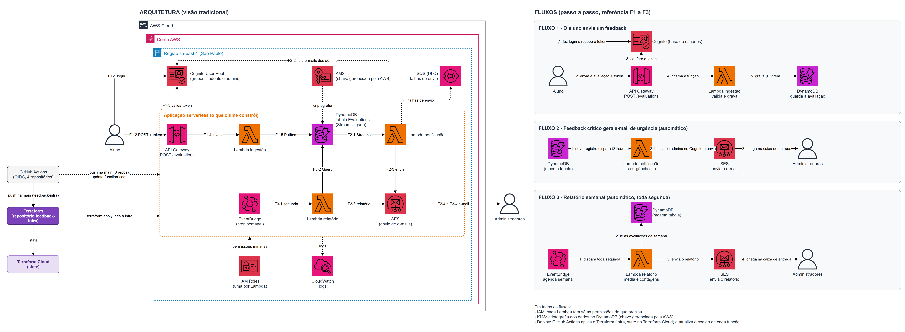

# feedback-lambda-notification

**Notification** Lambda for the Class Feedback Platform — Tech Challenge phase 4, serverless architecture on AWS.

Students submit `POST /evaluations` with `{"description": string, "score": int 0..10}`.
Administrators receive an urgent-feedback email (low scores) and a weekly report.

## The 4 repositories

| Repository | Responsibility |
|---|---|
| [feedback-infra](../feedback-infra) | Terraform for all infrastructure |
| [feedback-lambda-ingestion](../feedback-lambda-ingestion) | Receives the evaluation and writes it to DynamoDB |
| **feedback-lambda-notification** (this one) | Notifies admins by email when urgency is high |
| [feedback-lambda-report](../feedback-lambda-report) | Generates and sends the weekly report |

## Architecture



Diagram source: [`docs/architecture.drawio`](../feedback-infra/docs/architecture.drawio) in feedback-infra.

## What it does

Triggered by **DynamoDB Streams** on the `Evaluations` table. For each new `high` urgency evaluation (score 0 to 3), it looks up the members of the Cognito `admins` group and sends each one an email through SES.

- **Function:** `feedback-notification` · Java 21 · 512 MB · `sa-east-1`
- **Trigger:** stream filtered to `INSERT` + `urgency = high`, batch size 1, 2 retries, then the event goes to the SQS DLQ `feedback-notification-dlq`
- **Permissions:** read the table stream, `cognito-idp:ListUsersInGroup`, `ses:SendEmail`, `sqs:SendMessage` (DLQ)
- **Environment variables:** `USER_POOL_ID`, `ADMIN_GROUP`, `SES_SENDER`

### Email

Content: evaluation description, urgency and submission date.

- One email per admin, so admins don't see each other's address.
- Only admins with a verified email receive it.
- Errors are not swallowed: the stream retries and then keeps the event in the DLQ.

## Code structure

Hexagonal architecture (ports and adapters), enforced by ArchUnit tests.

```
com.feedback.notification
├── NotificationHandler         # Lambda entry point
├── domain/                     # CriticalEvaluation, EmailMessage, Urgency, UrgencyEmailRenderer
├── application/                # NotifyAdminsUseCase and output ports
├── adapter/in/dynamodbstream/  # Stream record → command
├── adapter/out/cognito/        # AdminDirectory on Cognito
├── adapter/out/ses/            # EmailSender on SES
└── config/                     # Environment variables and dependency wiring
```

## Build and test

```bash
./mvnw verify
```

Unit tests mock Cognito and SES (no AWS calls). The build fails below **80% coverage** (JaCoCo) and produces the shaded jar in `target/`.

## Pipeline

`.github/workflows/ci-cd.yml`:

- **Pull request:** build and test.
- **Push to `main`:** build, test and publish the jar with `aws lambda update-function-code`, authenticated through GitHub OIDC (no static AWS keys). The role, `feedback-github-lambda-notification`, can only update this function's code.

Required GitHub variable: `AWS_ROLE_ARN` (output `function_pipeline_role_arns` of `feedback-infra`).

**LGPD:** logs contain only ids and counts, never email addresses or the description.
